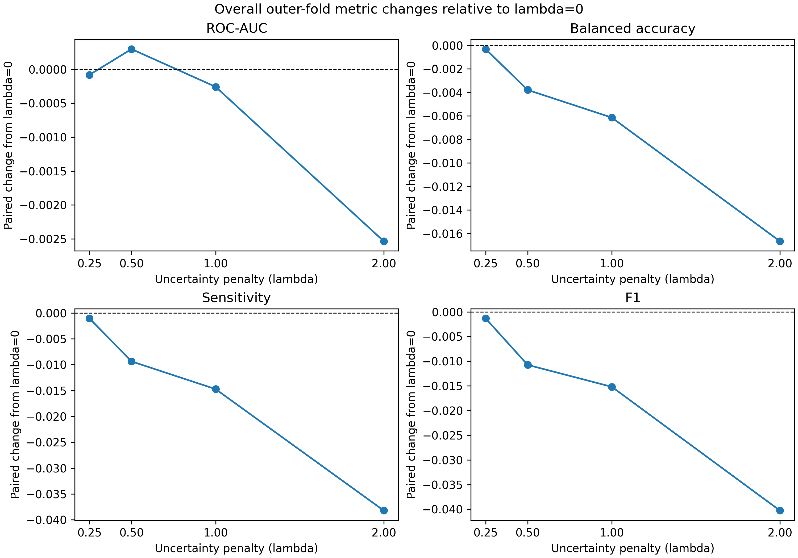
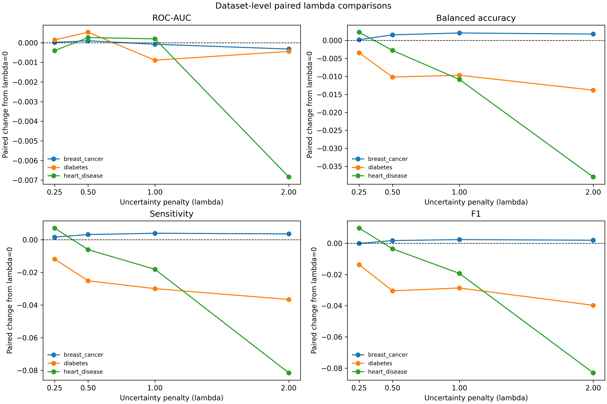
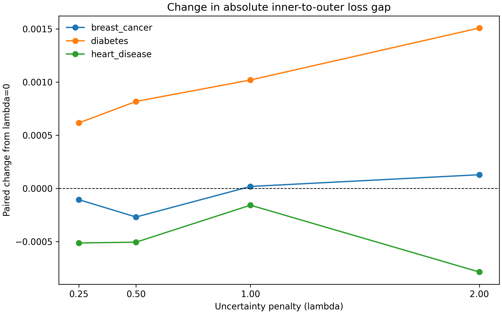
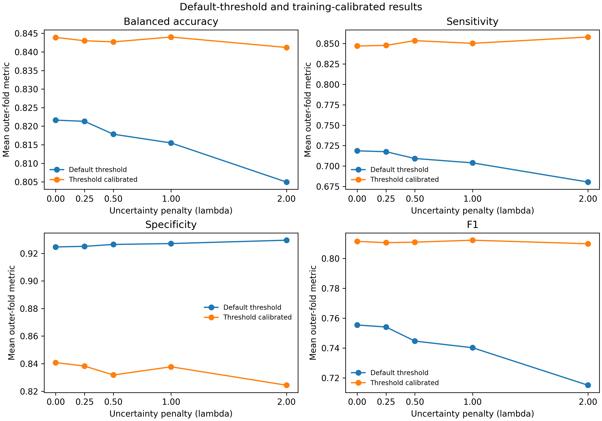

# Evaluating Uncertainty-Aware PSO-Tuned SVM Selection on Small Medical Datasets

## Abstract

Hyperparameter selection by cross-validation can prefer models whose measured
performance is sensitive to the particular folds used. This study evaluates
whether incorporating the sample standard deviation of inner-fold loss into
particle swarm optimization (PSO) changes the outer-fold performance of
radial-basis-function support vector machines (RBF-SVMs) on three small
medical benchmark datasets. Four methods are distinguished: standard PSO
(M1), post-hoc uncertainty-aware selection from an M1 candidate pool (M2),
uncertainty-aware PSO with the penalty applied during fitness and best updates
(M3), and equal-budget random search (M4). The final seeded sensitivity
experiment compares lambda values 0, 0.25, 0.5, 1, and 2 over three seeds,
using nested stratified five-fold cross-validation and an eight-particle,
six-iteration search. Lambda 0 is the standard mean-loss PSO objective.
Results are mixed: at lambda 1, the three-seed M3 comparison does not show
consistent gains over M1, and its absolute inner-to-outer gap is smaller in
71, larger in 75, and equal in 34 of 180 matched comparisons. Lambda effects
vary by dataset, metric, and preprocessing configuration. These descriptive
experiments do not establish superiority, overtuning mitigation, statistical
significance, or clinical benefit. The exact provenance and license terms of
the local Pima CSV remain unresolved.

## 1. Introduction

Model selection estimates performance from finite validation data. When the
validation sample is small, a search can be affected by which observations
fall into each fold. A natural question is whether a candidate's variability
across inner folds provides useful selection information in addition to its
mean loss. This work studies that question for RBF-SVM hyperparameter search
on three established small binary medical datasets.

The research question is: **Across these datasets and preprocessing
pipelines, how does penalizing the sample standard deviation of inner-fold
loss during PSO fitness evaluation affect outer-fold predictive metrics and
the inner-to-outer loss gap, compared with standard PSO?** The experiment is
comparative and exploratory. A smaller validation gap is not assumed to be a
valid or sufficient indicator of reduced overtuning.

The main evidence for lambda sensitivity comes from the completed,
explicitly seeded three-seed experiment. Earlier v2 results are retained as
historical context and are not pooled with the final seeded sensitivity
results.

## 2. Methods

### 2.1 Methods under comparison

For candidate \(j\), let \(L_{jk}\) denote the loss on inner fold \(k\):
\[
L_{jk}=1-\mathrm{ROC\mbox{-}AUC}_{jk},
\]
where ROC-AUC uses continuous decision scores. Across the five inner folds,
\(\bar L_j\) is the mean loss and \(s_j\) is its sample standard deviation
(`ddof=1`). The uncertainty-penalized criterion is
\[
J_{\lambda}(j)=\bar L_j+\lambda s_j.
\]

- **M1 — Standard PSO:** minimizes \(\bar L_j\) for fitness, personal-best
  and global-best updates, and final candidate selection.
- **M2 — Post-hoc uncertainty-aware selection:** selects from the recorded
  M1 candidate pool by \(J_1(j)\). It does not change the PSO trajectory.
- **M3 — Uncertainty-aware PSO:** uses \(J_\lambda(j)\) during fitness
  evaluation and personal/global-best updates, then selects from the
  lambda-specific candidate history. Nonzero lambda can therefore change
  which positions the swarm explores.
- **M4 — Random search:** evaluates an equal-budget set of uniformly sampled
  points in the same parameter bounds and selects by mean inner loss. It does
  not use PSO best updates.

Lambda 0 is the standard mean-loss PSO objective. Lambda 1 was the primary
penalty in the earlier v2 and M1/M3 comparisons. Lambda values 0.25, 0.5, and
2 are sensitivity analyses; they were declared before the sensitivity run
and were not selected using outer-test outcomes.

### 2.2 Datasets and preprocessing

The experiments use three datasets:

1. **Wisconsin Diagnostic Breast Cancer:** 569 rows and 30 numeric
   predictors after excluding the ID; malignant is the positive class.
2. **Pima Indians Diabetes:** 768 rows and 8 predictors. The loader treats
   zero values in glucose, blood pressure, skin thickness, insulin, and BMI
   as missing; this is a modeling assumption.
3. **Cleveland Heart Disease:** 303 rows and 13 predictors. Original target
   0 is mapped to negative and 1–4 to positive. The designated categorical
   features are encoded in the preprocessing pipeline.

Each dataset is evaluated with four configurations: median imputation,
mean imputation, PCA retaining 95% variance after median imputation, and
five-component TruncatedSVD after median imputation. Scaling, imputation,
encoding, PCA, and SVD are fitted on the current training partition only.
Dataset details and local-file limitations are recorded in
[`docs/dataset_audit.md`](../docs/dataset_audit.md).

### 2.3 Nested cross-validation and optimization

The final v2 and multi-seed studies use nested stratified five-fold outer and
five-fold inner cross-validation. Search parameters are
\(\log_{10}(C)\) and \(\log_{10}(\gamma)\), each bounded by \([-3,3]\), for an
RBF-SVM. The final v2/M1-M3/lambda experiments use eight particles and six
iterations, a nominal budget of 48 candidate evaluations per search. Matched
lambda comparisons share outer and inner splits and, for each matched search,
the same initial particle positions. Seeds 42, 43, and 44 are used in both
multi-seed comparisons.

All tuning occurs inside the outer-training partition. The selected model is
refit on the complete outer-training partition and evaluated once on the
untouched outer test fold. The historical implementation used six particles
and four iterations; it is not the final multi-seed search budget.

### 2.4 Thresholds and evaluation metrics

Default-threshold metrics use the SVC's default prediction threshold.
Separately, threshold-calibrated metrics use a threshold selected to maximize
balanced accuracy on inner out-of-fold decision scores from the outer
training data. The selected threshold is applied to outer-test scores after
refitting on all outer-training observations. Outer-test labels are not used
for threshold or hyperparameter selection. A possible score-scale mismatch
between inner-fold models and the refitted model is a calibration limitation.
ROC-AUC uses continuous outer-test decision scores and is reported separately
from threshold-dependent metrics.

The reported classification metrics are ROC-AUC, balanced accuracy,
sensitivity, specificity, and F1. For the selected candidate, mean and
sample-SD inner loss, \(C\), \(\gamma\), candidate evaluations, and runtime
are also recorded. The signed inner-to-outer loss gap is
\[
G=(1-\mathrm{outer\ ROC\mbox{-}AUC})-\bar L_j.
\]
Its absolute value is reported as a descriptive discrepancy. The sign of
\(G\) is not intrinsically good or bad.

### 2.5 Pairing and aggregation

For each nonzero lambda, results are paired to lambda 0 by seed, dataset,
preprocessing configuration, and outer fold. The analysis script recomputes
the fold-level differences from the raw result CSVs and verifies them against
the saved paired tables. Figures and summaries average folds within seed
before summarizing across the three seeds. Dataset-specific displays retain
the dataset strata. These summaries are descriptive: CV training sets
overlap, and all seeds reuse the same three datasets. No inferential test or
confidence interval is reported.

## 3. Results

### 3.1 Four-method v2 comparison

The original v2 findings summary reports unweighted descriptive means over
60 dataset/configuration/fold rows per method. This is a one-seed historical
comparison; its TruncatedSVD configuration recorded `random_state: null`.

| Method | ROC-AUC | Balanced accuracy | Sensitivity | Specificity | F1 |
|---|---:|---:|---:|---:|---:|
| M1 Standard PSO | 0.9109 | 0.8262 | 0.7321 | 0.9204 | 0.7697 |
| M2 Post-hoc uncertainty-aware | 0.9113 | 0.8233 | 0.7257 | 0.9209 | 0.7629 |
| M3 UA-PSO, lambda 1 | 0.9123 | 0.8286 | 0.7341 | 0.9230 | 0.7683 |
| M4 Random search | 0.9105 | 0.8109 | 0.6952 | 0.9266 | 0.7312 |

The results vary across datasets. For example, the v2 paired M3-minus-M1
balanced-accuracy difference was -0.0123 on Diabetes, +0.0022 on Breast
Cancer, and +0.0170 on Heart Disease. This single-seed table is not pooled
with the later seeded sensitivity study.

### 3.2 Three-seed M1/M3 comparison at lambda 1

Across the completed matched multi-seed fold rows, the descriptive average
M3-minus-M1 differences were approximately -0.0003 in ROC-AUC, -0.0061 in
balanced accuracy, -0.0147 in sensitivity, +0.0025 in specificity, and
-0.0152 in F1. Their direction varies by dataset and preprocessing; for
example, Breast Cancer generally showed small positive changes in several
metrics, while Diabetes PCA and Heart Disease PCA showed notable decreases
in sensitivity and F1.

The absolute inner-to-outer gap was smaller for M3 in 71 of 180 matched
comparisons, larger in 75, and equal in 34. This is not consistent gap
reduction and does not demonstrate overtuning mitigation.

### 3.3 Three-seed lambda sensitivity

The final seeded experiment contains 900 default-threshold rows and 900
calibrated rows (three seeds × three datasets × four preprocessing
configurations × five outer folds × five lambda values). The raw outputs and
validated paired comparisons are stored in
[`experiments/uncertainty_aware_pso_lambda_multiseed/`](../experiments/uncertainty_aware_pso_lambda_multiseed/).
This corresponds to 900 searches and 43,200 candidate evaluations. The saved
run findings record elapsed times of 1,680.94 seconds for seed 42, 2,079.09
seconds for seed 43, and 4,215.05 seconds for seed 44 (7,975.08 seconds,
2.22 hours total sequential elapsed time); these are observed timings from
this machine, not a runtime guarantee.

Across all matched rows, mean paired default-threshold changes from lambda 0
were:

| Lambda | Δ ROC-AUC | Δ balanced accuracy | Δ sensitivity | Δ specificity | Δ F1 | Δ absolute gap |
|---:|---:|---:|---:|---:|---:|---:|
| 0.25 | -0.0001 | -0.0003 | -0.0011 | +0.0004 | -0.0013 | -0.0000 |
| 0.5 | +0.0003 | -0.0038 | -0.0094 | +0.0018 | -0.0108 | +0.0000 |
| 1 | -0.0003 | -0.0061 | -0.0147 | +0.0025 | -0.0152 | +0.0003 |
| 2 | -0.0025 | -0.0167 | -0.0382 | +0.0049 | -0.0403 | +0.0003 |

Dataset summaries illustrate heterogeneity. At lambda 1, Breast Cancer had
small average improvements in balanced accuracy (+0.0021), sensitivity
(+0.0039), and F1 (+0.0024), with approximately unchanged AUC and absolute
gap. Diabetes had lower balanced accuracy (-0.0097), sensitivity (-0.0300),
and F1 (-0.0287), alongside higher specificity (+0.0107); its absolute gap
increased by about 0.0010. Heart Disease showed lower balanced accuracy
(-0.0108), sensitivity (-0.0181), and F1 (-0.0193), with a small positive
AUC change (+0.0002). These are descriptive averages across preprocessing
configurations, folds, and three seed-level summaries.

The largest observed degradations are not uniform across preprocessing.
In the saved default-threshold paired table, Diabetes mean-imputation at
lambda 2 has especially large negative F1 and sensitivity changes; Heart
Disease PCA and SVD also show larger negative classification changes at
some lambda values. Conversely, selected configurations show small gains.
The output figures and full dataset/configuration summaries are in
[`deliverables/`](.).

### 3.4 Threshold calibration and generalization gap

Threshold calibration is reported separately from default-threshold
classification. It changes operating-point metrics, not continuous-score
ROC-AUC. The calibrated metrics and fold-level paired comparisons are saved
separately and shown in
[`figures/threshold_mode_comparison.png`](figures/threshold_mode_comparison.png).

Across lambda values, average changes in absolute gap are close to zero and
vary in direction by dataset. Similarly, the three-seed M1/M3 absolute-gap
counts do not support consistent reduction. A smaller absolute gap should not
be interpreted on its own as better test performance or evidence that
overtuning has been mitigated.

### 3.5 Figures

The figures are generated from the saved fold-level CSVs by
[`analyze_final_results.py`](analyze_final_results.py). They summarize paired
differences after averaging within seed; no fold-level significance
interpretation is implied.

## 4. Limitations

1. Only three datasets and three random seeds were studied. The seeds do not
   constitute independent datasets or establish broad seed stability.
2. Nested cross-validation folds overlap in their training observations.
   Fold-level rows are paired for comparison but are not independent
   inferential samples.
3. The datasets are small, and the Diabetes preprocessing rule treats
   selected zeros as missing based on a modeling convention.
4. The exact source/version of the local Pima CSV and redistribution terms
   for local dataset files have not been verified. Hashes identify the local
   file bytes but do not establish provenance or license.
5. Historical v2 saved outputs used an unseeded TruncatedSVD configuration.
   Later code and the completed final lambda runs explicitly seed SVD, but
   the historical outputs were not regenerated.
6. Threshold calibration uses inner-fold scores to choose a threshold that
   is applied to a refitted model; score-scale mismatch is possible.
7. Metrics, gap comparisons, and lambda summaries are descriptive. No
   significance tests, external validation, clinical utility analysis, or
   independent-site evaluation were performed.

## 5. Conclusion

The saved experiments establish that lambda changes the M3 search trajectory
and selected candidates, but they do not establish that uncertainty-aware
PSO improves predictive performance or consistently reduces the
inner-to-outer gap. Effects depend on dataset, preprocessing, lambda, and
threshold mode. The most useful next investigation is a preregistered,
independently sourced external validation study that preserves paired
training splits, evaluates clinically relevant operating points, and
resolves data provenance before making broader claims.

## References

1. W. H. Wolberg, O. L. Mangasarian, and N. Street, “Nuclear feature
   extraction for breast tumor diagnosis,” *Electronic Imaging* (1993).
   UCI dataset 17, DOI: [10.24432/C5DW2B](https://doi.org/10.24432/C5DW2B).
2. J. W. Smith, J. E. Everhart, W. C. Dickson, W. C. Knowler, and
   R. S. Johannes, “Using the ADAP learning algorithm to forecast the onset
   of diabetes mellitus,” *Proceedings of the Symposium on Computer
   Applications in Medical Care* (1988), pp. 261–265. The exact local CSV
   provenance remains unverified.
3. R. Detrano et al., “International application of a new probability
   algorithm for the diagnosis of coronary artery disease,” *American
   Journal of Cardiology* (1989). UCI Heart Disease dataset 45, DOI:
   [10.24432/C52P4G](https://doi.org/10.24432/C52P4G).
4. C. Cortes and V. Vapnik, “Support-vector networks,” *Machine Learning*,
   20, 273–297 (1995). [doi:10.1007/BF00994018](https://doi.org/10.1007/BF00994018).
5. J. Kennedy and R. Eberhart, “Particle swarm optimization,” *Proceedings
   of ICNN'95* (1995), pp. 1942–1948.
   [doi:10.1109/ICNN.1995.488968](https://doi.org/10.1109/ICNN.1995.488968).
6. M. Stone, “Cross-validatory choice and assessment of statistical
   predictions,” *Journal of the Royal Statistical Society: Series B*,
   36(2), 111–147 (1974).
   [doi:10.1111/j.2517-6161.1974.tb00994.x](https://doi.org/10.1111/j.2517-6161.1974.tb00994.x).
7. F. Pedregosa et al., “Scikit-learn: Machine Learning in Python,”
   *Journal of Machine Learning Research*, 12, 2825–2830 (2011).
   [JMLR article](https://jmlr.org/papers/v12/pedregosa11a.html).
